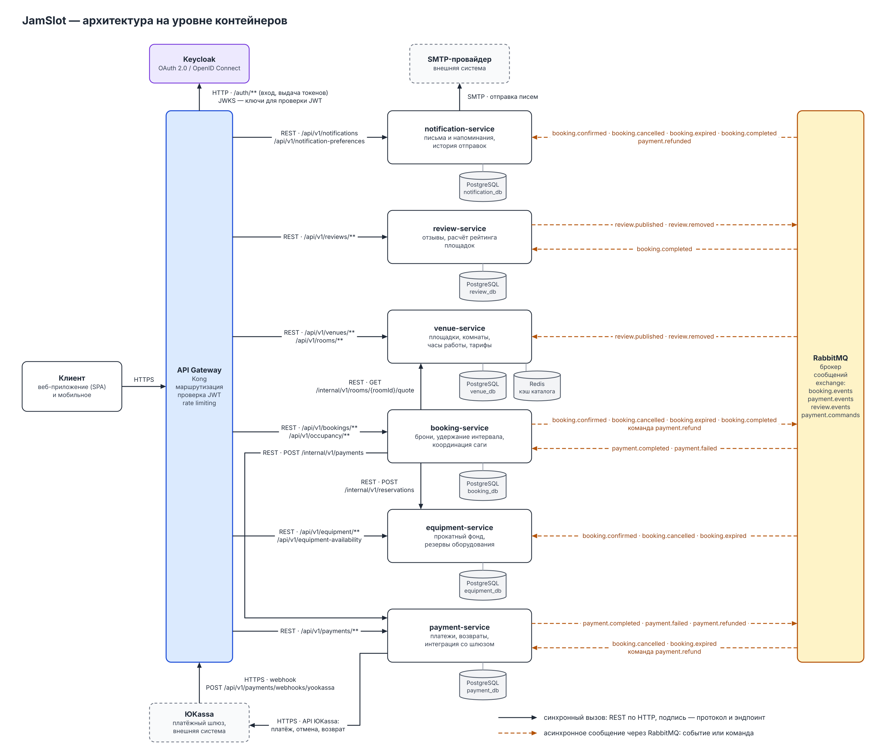
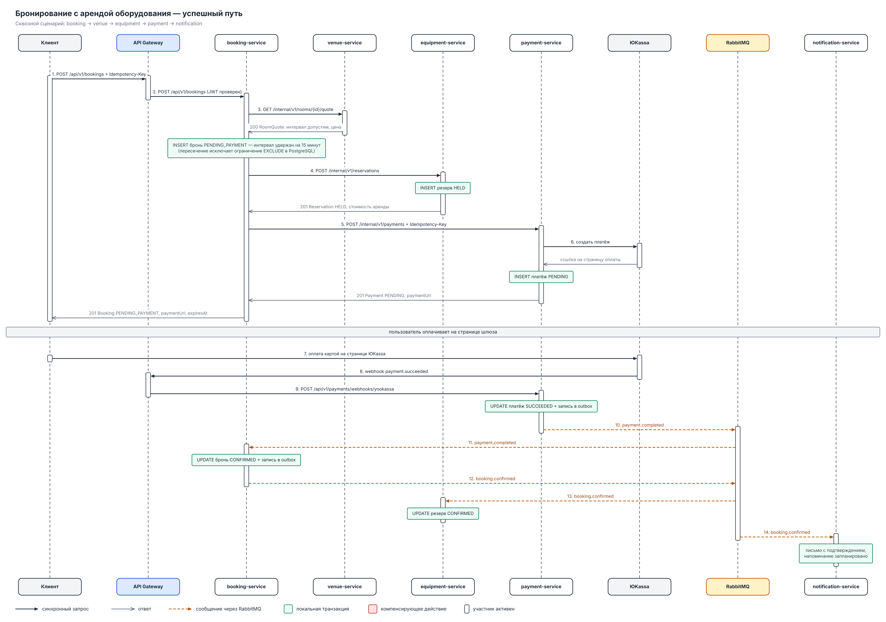
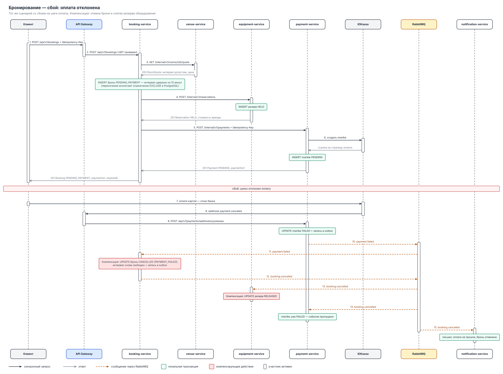
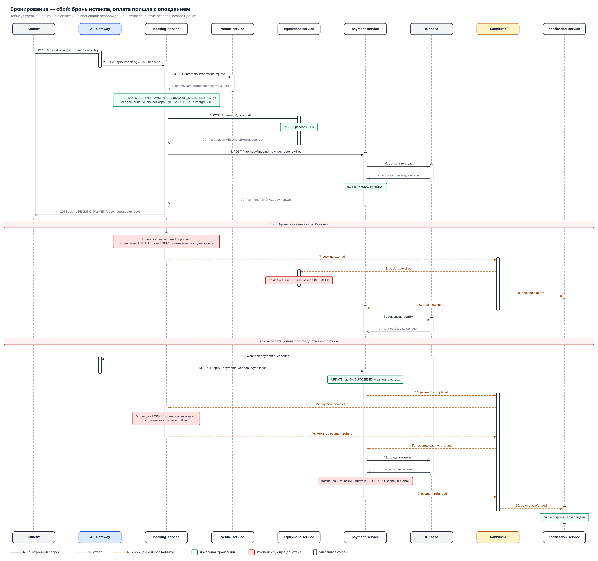

# JamSlot — бронирование репетиционных комнат и студий


Сервис для музыкантов: найти репетиционную базу, забронировать комнату на несколько часов, взять в аренду оборудование и оплатить всё одним платежом.

- **ЛР3 «Декомпозиция и проектирование микросервисной системы»** — предметная область, границы сервисов, схемы, контракты API (вторая часть этого файла).
- **ЛР4 «Реализация микросервисов»** — пять сервисов, API Gateway, docker-compose, моки, тесты (первая часть).
- **ЛР5 "CI/CD пайплайн"** — пайплайн непрерывной интеграции и доставки

| Что | Где |
|---|---|
| Исходный код сервисов | [`services/`](services/) |
| Локальный запуск | [`docker-compose.yml`](docker-compose.yml) |
| Моки внешних систем (WireMock) | [`mocks/wiremock/`](mocks/wiremock/) |
| Коллекция запросов | [`postman/JamSlot.postman_collection.json`](postman/JamSlot.postman_collection.json) |
| Проверенные сценарии | [`docs/demo-scenarios.md`](docs/demo-scenarios.md) |
| Тесты | [`tests/`](tests/) |
| Схемы ЛР3 | [`docs/`](docs/) |
| OpenAPI и AsyncAPI ЛР3 | [`api/`](api/) |

---

# Реализация микросервисов

## Соответствие минимальным требованиям

| Требование ЛР4 | Как выполнено |
|---|---|
| Не менее 4 бизнес-сервисов из ЛР3 | 5: venue, booking, equipment, payment, notification |
| Своё хранилище у каждого сервиса | своя база PostgreSQL и своя учётная запись на сервис ([`infra/postgres/init.sql`](infra/postgres/init.sql)); в тестах — свой файл SQLite |
| Не менее 3 синхронных взаимодействий по контрактам | 3 REST-вызова: booking → venue, booking → equipment, booking → payment |
| Не менее 2 асинхронных взаимодействий через брокер | 8 типов сообщений (7 событий и команда `payment.refund`) через RabbitMQ, 7 очередей-подписок в 5 сервисах |
| Сквозной сценарий на 3+ сервиса с обработкой сбоев | сага бронирования: venue → booking → equipment → payment → notification, компенсации при отказе оплаты, нехватке оборудования, недоступности сервиса и истечении брони |
| Клиент обращается только через API Gateway | Gateway на `:8000` — единственный опубликованный порт сервисов; `/internal/**` наружу закрыт |
| `Idempotency-Key` для повторяемых операций | все `POST`, создающие или меняющие данные, включая внутренние вызовы саги |
| Единая модель ошибок | Problem Details (RFC 9457 / 7807) во всех сервисах и в Gateway |
| Docker Compose | поднимает 5 сервисов, Gateway, PostgreSQL, RabbitMQ, WireMock и Mailpit |
| Unit- и интеграционные тесты | 74 теста: бизнес-правила, библиотека, эндпоинты, сквозные сценарии со сбоями |

## Реализованные сервисы

| Сервис | Публичный API (через Gateway) | Внутренний API | Публикует | Подписан на |
|---|---|---|---|---|
| **venue-service** | площадки и комнаты: 9 операций | `GET /internal/v1/rooms/{id}/quote` | — | `review.published`, `review.removed` |
| **booking-service** | брони, отмена, занятость комнаты | — | `booking.confirmed`, `booking.cancelled`, `booking.expired`, `booking.completed`, команда `payment.refund` | `payment.completed`, `payment.failed` |
| **equipment-service** | прокатный фонд, доступность на интервал | `POST /internal/v1/reservations`, `GET /internal/v1/reservations/{id}` | — | `booking.confirmed`, `booking.cancelled`, `booking.expired` |
| **payment-service** | платежи, webhook ЮKassa | `POST /internal/v1/payments` | `payment.completed`, `payment.failed`, `payment.refunded` | `booking.cancelled`, `booking.expired`, команда `payment.refund` |
| **notification-service** | история уведомлений, настройки | — | — | `booking.*`, `payment.refunded` |
| **api-gateway** | `/auth/token` (мок Keycloak), прокси `/api/v1/**` | — | — | — |

Все 28 операций из OpenAPI этих сервисов реализованы. Тест `test_every_operation_of_implemented_services_is_exercised` вызывает каждую и сверяет список с `api/*.yaml`. **review-service не реализован** (минимум ЛР4 — четыре сервиса). Его событие `review.published` venue-service уже обрабатывает — это проверено тестом.

## Шаг 1. Выбор стека

| Компонент | Выбор | Почему |
|---|---|---|
| Язык и фреймворк | Python 3.13 + Flask 3 | Один стек на все сервисы: общий код (outbox, идемпотентность, Problem Details) пишется один раз. Flask — тонкий синхронный фреймворк без магии: в коде видно, где транзакция, где вызов соседа и где публикация события. Для курса, где главное — взаимодействия, это важнее скорости |
| Валидация | pydantic 2 | Схемы запросов повторяют `components/schemas` из OpenAPI, ошибки превращаются в `400` со списком полей |
| WSGI-сервер | gunicorn, 1 процесс × 8 потоков | Фоновые потоки (outbox, подписки, планировщик) живут в одном процессе с API |
| БД | PostgreSQL 17 через psycopg 3 | Как в ЛР3: пересечение интервалов брони запрещает ограничение `EXCLUDE USING gist`. Код запросов общий для PostgreSQL и SQLite, поэтому тесты идут без Docker |
| Брокер | RabbitMQ 4 через pika | Как в ЛР3: topic-exchange для событий, direct-exchange для команды |
| HTTP между сервисами | requests | Таймаут, один повтор для безопасных запросов, circuit breaker |
| Тесты | pytest + jsonschema | Ответы, внутренние запросы и события сверяются с OpenAPI/AsyncAPI ЛР3 |

## Что работает через реальные сервисы, а что через моки

| Взаимодействие | Реализация |
|---|---|
| Клиент → Gateway → сервисы | реально |
| booking → venue, booking → equipment, booking → payment (REST) | реально |
| Все события и команды (RabbitMQ) | реально |
| Хранилища (PostgreSQL) | реально |
| payment → ЮKassa: создание, отмена платежа, возврат | **мок: WireMock** ([`mocks/wiremock/mappings`](mocks/wiremock/mappings)). Стабы проверяют контракт: Basic-авторизацию магазина, `Idempotence-Key`, обязательные поля тела; иначе отвечают `401` |
| ЮKassa → payment: уведомление об оплате | **мок:** webhook отправляется из Postman |
| notification → почта | **мок: Mailpit** (SMTP + веб-интерфейс) |
| Keycloak | **мок:** `POST /auth/token` в Gateway выдаёт подписанный JWT демо-пользователям |
| review-service | не реализован; venue-service обрабатывает его события, если они приходят |

В автотестах те же сервисы собираются в одном процессе: брокер — `InMemoryBroker` с маршрутизацией как у RabbitMQ, ЮKassa — эмулятор, который читает **те же** стабы из `mocks/wiremock`. Подробнее — [`docs/demo-scenarios.md`](docs/demo-scenarios.md).

## Отличия от проекта ЛР3

| В ЛР3 | В ЛР4 | Причина |
|---|---|---|
| Kong Gateway | минимальный Gateway на Flask | ЛР4 разрешает минимальную реализацию; в Gateway в одном месте маршрутизация, проверка JWT, лимит запросов и мок Keycloak |
| Keycloak | мок выдачи токенов в Gateway | Разрешено условием; формат токена тот же (`sub`, `roles`, `venue_ids`) |
| Токены сервисных учётных записей на `/internal/**` | доверие внутренней сети + заголовок `X-Service-Name` | `/internal/**` закрыт на Gateway и не опубликован наружу |
| Проверка IP-адреса ЮKassa на Gateway | не делается | Webhook приходит из Postman |
| Redis-кэш каталога | не используется | Нагрузки нет, кэш не влияет на взаимодействия |
| review-service | не реализован | Достаточно четырёх сервисов |

## Запуск

Нужен Docker Desktop. Все образы есть в сборке для Apple Silicon (arm64).

```bash
docker compose up -d --build     # первая сборка — несколько минут
docker compose ps                # все сервисы в статусе healthy
curl http://localhost:8000/api/v1/venues
```

| Адрес | Что там |
|---|---|
| http://localhost:8000 | API Gateway — единственная точка входа |
| http://localhost:8025 | Mailpit — письма пользователям |
| http://localhost:15672 | RabbitMQ (логин и пароль `jamslot`) |
| http://localhost:8089/__admin/requests | WireMock — журнал запросов к мок-ЮKassa |
| `localhost:5433` | PostgreSQL (`postgres` / `postgres`), базы `*_db` |

Остановить: `docker compose down`. Удалить и данные: `docker compose down -v`.

## Проверка сценариев

1. Импортировать в Postman `postman/JamSlot.postman_collection.json`.
2. Запустить папку «0. Подготовка», затем 1–7 — через Run folder или по одному запросу. Каждый запрос содержит проверки (вкладка Tests).
3. Папки 8 и 9 требуют команд в терминале — они в описании папок и в [`docs/demo-scenarios.md`](docs/demo-scenarios.md).

Без Postman — через Newman: `npx newman run postman/JamSlot.postman_collection.json --folder "0. Подготовка" --folder "2. Успешный сценарий (happy path)"`.

## Тесты

```bash
python3 -m venv .venv && source .venv/bin/activate
pip install -r requirements-dev.txt
pytest
```

| Набор | Что проверяет |
|---|---|
| `tests/unit` (37) | правила интервалов и отмены, переходы статусов, деньги и время; идемпотентность, outbox, дедупликация событий, повторы и DLQ, HTTP-клиент с повтором и circuit breaker |
| `tests/integration` (19) | эндпоинты через Gateway: права, валидация, пагинация, ошибки; ограничение `EXCLUDE` в PostgreSQL; покрытие всех операций OpenAPI |
| `tests/e2e` (18) | сквозная сага: успешный путь и все сбои с компенсациями, идемпотентность, повторная доставка событий |

Тесты не требуют Docker. Каждый ответ сервиса, каждый внутренний запрос и каждое опубликованное событие автоматически сверяются с `api/*.yaml` и `api/asyncapi.yaml`: расхождение с контрактом роняет тест. По умолчанию базы — SQLite; тот же набор проходит и на PostgreSQL 16.

## Структура

```
services/
  common/jamslot_common/   общий код: БД, брокер и outbox, идемпотентность, Problem Details, HTTP-клиент
  gateway/                 API Gateway
  venue-service/           каталог площадок
  booking-service/         брони и оркестрация саги
  equipment-service/       прокат оборудования
  payment-service/         платежи и интеграция с ЮKassa
  notification-service/    письма и напоминания
  Dockerfile               общий образ, сервис выбирается build-аргументами
infra/postgres/init.sql    базы и учётные записи сервисов
mocks/wiremock/            стабы ЮKassa
postman/                   коллекция сценариев
tests/                     unit, integration, e2e и общая обвязка (support/)
docs/demo-scenarios.md     описание проверенных сценариев
```

---

# Декомпозиция и проектирование

Соответствие минимальным требованиям:

| Требование | Как выполнено |
|---|---|
| 4–7 бизнес-сервисов | 6: venue, booking, equipment, payment, review, notification |
| ≥ 3 синхронных взаимодействий между сервисами | 3: booking → venue, booking → equipment, booking → payment (раздел 5.3, № 8–10) |
| ≥ 2 асинхронных взаимодействий | 10 типов сообщений, 8 подписок (раздел 6) |
| Сценарий на 3+ сервиса с согласованностью данных | сага бронирования: booking + equipment + payment (+ venue, notification), раздел 5.4 |
| Своё хранилище у каждого сервиса | 6 отдельных баз PostgreSQL, общих таблиц нет |
| Клиент ходит только через API Gateway | Kong; пути `/internal/**` наружу не опубликованы |

## 1. Предметная область

### 1.1. Описание

JamSlot — сервис для музыкантов и владельцев репетиционных баз и студий звукозаписи. Музыкант находит площадку в своём городе, выбирает комнату и свободный интервал, при необходимости добавляет к брони оборудование в аренду (гитару, тарелки, микрофон) и оплачивает всё одним платежом. Менеджер площадки ведёт комнаты, тарифы и прокатный фонд и видит брони своей площадки. После репетиции музыкант оставляет отзыв, из отзывов складывается рейтинг площадки.

Единица бронирования — не место, как в кинотеатре, а временной интервал комнаты, кратный часу. Поэтому главная техническая задача — не допустить пересечения интервалов и при этом согласовать три независимых ресурса: время комнаты, единицы оборудования и деньги.

### 1.2. Акторы

| Актор | Тип | Что делает |
|---|---|---|
| Музыкант (клиент) | пользователь | ищет площадки, бронирует, платит, отменяет, пишет отзывы |
| Менеджер площадки | пользователь | ведёт площадку, комнаты, тарифы, оборудование; видит брони площадки |
| Администратор платформы | пользователь | модерирует отзывы, скрывает площадки |
| ЮKassa | внешняя система | платёжный шлюз: страница оплаты, уведомления о статусе, возвраты |
| SMTP-провайдер | внешняя система | доставка писем |
| Keycloak | готовое ПО | регистрация, вход, выдача токенов, роли `client`, `venue_manager`, `admin` |

### 1.3. Пользовательские сценарии

1. Как музыкант, я хочу найти площадки в своём городе с фильтром по типу комнаты, чтобы выбрать, где репетировать.
2. Как музыкант, я хочу видеть занятые интервалы комнаты на выбранную дату, чтобы подобрать свободное время.
3. Как музыкант, я хочу забронировать комнату на несколько часов и добавить оборудование в аренду, чтобы не везти свой инструмент.
4. Как музыкант, я хочу оплатить бронь онлайн и получить письмо с подтверждением, чтобы быть уверенным, что комната за мной.
5. Как музыкант, я хочу отменить бронь и получить деньги обратно, если отменяю не позже чем за 24 часа, чтобы не терять деньги при переносе репетиции.
6. Как музыкант, я хочу оставить отзыв после репетиции, чтобы помочь другим выбрать площадку.
7. Как менеджер площадки, я хочу управлять комнатами, тарифами и прокатным фондом, чтобы в каталоге были актуальные данные.
8. Как менеджер площадки, я хочу видеть список броней своей площадки, чтобы готовить комнаты и оборудование.

---

## 2. Доменные события и ограниченные контексты

### 2.1. Доменные события

Результат упрощённого Event Storming. Жирным выделены события, которые выходят за границу контекста и публикуются в брокер.

| Контекст | События |
|---|---|
| Каталог площадок | ПлощадкаСоздана, КомнатаДобавлена, ТарифИзменён, ПлощадкаСкрыта, РейтингПлощадкиОбновлён |
| Бронирование | БроньСоздана, ИнтервалУдержан, **БроньПодтверждена**, **БроньОтменена**, **БроньИстекла**, **БроньЗавершена**, ВозвратЗапрошен |
| Прокат оборудования | ПозицияДобавлена, ОборудованиеЗарезервировано, РезервПодтверждён, РезервСнят |
| Платежи | ПлатёжСоздан, **ОплатаПрошла**, **ОплатаОтклонена**, ПлатёжОтменён, **ДеньгиВозвращены** |
| Отзывы | **ОтзывОпубликован**, **ОтзывУдалён** |
| Уведомления | ПисьмоОтправлено, НапоминаниеЗапланировано, ОтправкаНеУдалась |

### 2.2. Ограниченные контексты и глоссарии

Одно и то же слово в разных контекстах означает разное. «Бронь» для бронирования — интервал и статус, для платежей — основание платежа с суммой, для проката — срок, на который заняты единицы оборудования, для отзывов — право оставить один отзыв. Поэтому общей сущности «Бронь» на всю систему нет: у каждого контекста своя модель, а связывает их только идентификатор `bookingId`.

**Каталог площадок (venue-service)**

| Термин | Значение в этом контексте |
|---|---|
| Площадка | репетиционная база или студия: адрес, часы работы, менеджер |
| Комната | помещение площадки, которое сдаётся по часам; имеет тип, вместимость и цену часа |
| Тариф | цена часа комнаты и минимальная длительность брони |
| Расчёт (quote) | проверка, что интервал допустим для комнаты, и его стоимость. Занятость сюда не входит |
| Рейтинг | копия агрегата из контекста отзывов, нужна только для показа в каталоге |

**Бронирование (booking-service)**

| Термин | Значение в этом контексте |
|---|---|
| Бронь | право клиента занять комнату на интервал; имеет статус и снимок цен на момент создания |
| Интервал | отрезок времени `[startsAt, endsAt)`, кратный часу |
| Удержание | состояние брони `PENDING_PAYMENT`: интервал занят, но не оплачен; живёт 15 минут |
| Занятость | множество интервалов комнаты, занятых бронями в статусах `PENDING_PAYMENT` и `CONFIRMED` |
| Сага бронирования | последовательность шагов «бронь → резерв оборудования → платёж» с компенсациями |

**Прокат оборудования (equipment-service)**

| Термин | Значение в этом контексте |
|---|---|
| Позиция | модель оборудования на площадке и число одинаковых единиц (например, 2 микрофона SM58) |
| Резерв | закрепление единиц за бронью на её интервал; статусы `HELD`, `CONFIRMED`, `RELEASED` |
| Доступность | число единиц позиции, не занятых резервами, пересекающими интервал |
| Бронь | только идентификатор и интервал; кто клиент и какая комната — этому контексту неизвестно |

**Платежи (payment-service)**

| Термин | Значение в этом контексте |
|---|---|
| Платёж | попытка получить сумму за бронь через шлюз; статусы `PENDING`, `SUCCEEDED`, `FAILED`, `CANCELLED`, `REFUNDED` |
| Возврат | операция возврата денег по оплаченному платежу |
| Уведомление шлюза | входящий webhook ЮKassa о смене статуса платежа или возврата |
| Бронь | основание платежа: идентификатор, сумма и срок оплаты |

**Отзывы (review-service)**

| Термин | Значение в этом контексте |
|---|---|
| Отзыв | оценка от 1 до 5 и текст, привязанные к одной завершённой брони |
| Завершённая бронь | локальная копия факта «клиент был на площадке»; даёт право на один отзыв |
| Рейтинг площадки | среднее и число опубликованных отзывов; источник истины — здесь |

**Уведомления (notification-service)**

| Термин | Значение в этом контексте |
|---|---|
| Уведомление | одно письмо пользователю с типом, статусом и временем отправки |
| Напоминание | уведомление, запланированное на время до начала репетиции |
| Настройки | какие письма пользователь согласен получать и за сколько часов напоминать |
| Получатель | имя и адрес почты из события брони; собственного профиля пользователя сервис не ведёт |

---

## 3. Сервисы

Авторизацию выполняет Keycloak, поэтому собственный сервис пользователей не пишется. Сервисы хранят только `userId` (claim `sub`), а имя и почту получают из токена. Привязку менеджера к площадкам хранит Keycloak в атрибуте пользователя, который попадает в токен как claim `venue_ids`; при создании площадки venue-service дописывает её идентификатор через Admin API Keycloak.

### 3.1. Карточки сервисов

#### venue-service

| Поле | Значение |
|---|---|
| Ответственность | Каталог: площадки, комнаты, часы работы и тарифы. Проверяет, допустим ли интервал для комнаты, и считает его стоимость. |
| Владеет данными | Площадка, Комната, Тариф, ЧасыРаботы |
| Предоставляет | REST: `GET/POST /api/v1/venues`, `GET/PATCH /api/v1/venues/{id}`, `GET/POST /api/v1/venues/{id}/rooms`, `GET/PATCH /api/v1/rooms/{id}`; internal: `GET /internal/v1/rooms/{id}/quote`. Событий не публикует. |
| Зависит от | Синхронно — ни от кого. Подписан на `review.published`, `review.removed` (копия рейтинга). |
| Нефункциональные требования | Самый читаемый сервис: оценка до 200 запросов/с на чтение при единицах записей в минуту. p95 чтения ≤ 100 мс. Недоступность блокирует поиск и создание новых броней, но не оплату уже созданных. |
| Обоснование границы | Разные НФТ: чтений на два порядка больше, чем записей, поэтому сервис кэшируется и масштабируется отдельно от бронирования. Владение данными: каталог меняет менеджер, бронь — клиент; частота и причины изменений разные. |

#### booking-service

| Поле | Значение |
|---|---|
| Ответственность | Бронирование интервалов: удержание на 15 минут, жизненный цикл брони, правила отмены. Координирует сагу бронирования. |
| Владеет данными | Бронь, Занятость комнаты, снимок цен брони |
| Предоставляет | REST: `POST/GET /api/v1/bookings`, `GET /api/v1/bookings/{id}`, `POST /api/v1/bookings/{id}/cancel`, `GET /api/v1/occupancy/rooms/{id}`. События: `booking.confirmed`, `booking.cancelled`, `booking.expired`, `booking.completed`. Команда: `payment.refund`. |
| Зависит от | Синхронно при создании брони: venue-service (расчёт), equipment-service (резерв), payment-service (платёж). Подписан на `payment.completed`, `payment.failed`. |
| Нефункциональные требования | Оценка до 20 созданий броней/с в вечерний пик. Строгая согласованность внутри сервиса: два клиента не могут занять пересекающиеся интервалы. p95 создания брони ≤ 1,5 с (три внешних вызова). Критичность высокая — это ядро бизнеса. |
| Обоснование границы | Бизнес-возможность «сдавать время комнаты» со своей сложной логикой конкуренции и таймаутов. Автономность: чтение броней и занятости не требует других сервисов; чужие данные (названия, цены) хранятся снимком. |

#### equipment-service

| Поле | Значение |
|---|---|
| Ответственность | Прокатный фонд площадок и резервирование единиц оборудования на интервал брони. |
| Владеет данными | ПозицияОборудования, Резерв |
| Предоставляет | REST: `GET/POST /api/v1/equipment`, `GET/PATCH /api/v1/equipment/{id}`, `GET /api/v1/equipment-availability`; internal: `POST /internal/v1/reservations`, `GET /internal/v1/reservations/{id}`. Событий не публикует. |
| Зависит от | Синхронно — ни от кого. Подписан на `booking.confirmed`, `booking.cancelled`, `booking.expired`. |
| Нефункциональные требования | Оценка до 10 резервов/с. Нельзя выдать больше единиц, чем есть: проверка остатка и запись резерва — одна транзакция. p95 резерва ≤ 300 мс. Недоступность блокирует только брони с арендой оборудования. |
| Обоснование границы | Владение данными: счётный ресурс с учётом количества — другая модель, чем интервал комнаты (там ресурс единичный). Слабое зацепление: прокат развивается независимо (залог, учёт износа, ремонт) и не должен менять ядро бронирования. |

#### payment-service

| Поле | Значение |
|---|---|
| Ответственность | Приём оплаты через ЮKassa, обработка уведомлений шлюза, возвраты. |
| Владеет данными | Платёж, Возврат, журнал уведомлений шлюза |
| Предоставляет | REST: `GET /api/v1/payments`, `GET /api/v1/payments/{id}`, `POST /api/v1/payments/webhooks/yookassa`; internal: `POST /internal/v1/payments`. События: `payment.completed`, `payment.failed`, `payment.refunded`. |
| Зависит от | Синхронно — от внешнего шлюза ЮKassa. Подписан на `booking.cancelled`, `booking.expired`, принимает команду `payment.refund`. |
| Нефункциональные требования | Оценка до 20 платежей/с. Недопустимы потеря и дублирование платежа: все операции идемпотентны, каждое изменение статуса журналируется. Webhook должен ответить шлюзу за 3 с. Критичность высокая. |
| Обоснование границы | Интеграция с внешней системой: нестабильность и таймауты шлюза изолированы в одном сервисе. Отдельные требования к аудиту и безопасности: только этот сервис хранит ключи шлюза. |

#### review-service

| Поле | Значение |
|---|---|
| Ответственность | Отзывы о площадках после состоявшихся броней и расчёт рейтинга. |
| Владеет данными | Отзыв, РейтингПлощадки, копия завершённых броней (право на отзыв) |
| Предоставляет | REST: `GET/POST /api/v1/reviews`, `GET/DELETE /api/v1/reviews/{id}`. События: `review.published`, `review.removed`. |
| Зависит от | Синхронно — ни от кого. Подписан на `booking.completed`. |
| Нефункциональные требования | Оценка до 50 чтений/с, записи — единицы в минуту. Допустима согласованность «в конечном счёте»: рейтинг в каталоге может отставать на секунды. Критичность низкая. |
| Обоснование границы | Автономность: сбой отзывов не должен мешать поиску и бронированию. Слабое зацепление: модерация и формула рейтинга меняются независимо от каталога. |

#### notification-service

| Поле | Значение |
|---|---|
| Ответственность | Письма о подтверждении, отмене, истечении брони и возврате; напоминания перед репетицией; приглашение оставить отзыв. |
| Владеет данными | Уведомление (история отправок), НастройкиУведомлений |
| Предоставляет | REST: `GET /api/v1/notifications`, `GET/PUT /api/v1/notification-preferences`. Событий не публикует. |
| Зависит от | Синхронно — от SMTP-провайдера. Подписан на все `booking.*` и `payment.refunded`. |
| Нефункциональные требования | Пиковая нагрузка равна потоку событий броней. Допустима задержка письма до 1 минуты. Сбой сервиса не влияет на бронирование: события ждут в очереди. |
| Обоснование границы | Не участвует в основном сценарии, его сбой не должен ломать покупку. Зависит от медленной внешней системы (SMTP), которую нельзя вызывать в запросе пользователя. |

### 3.2. Отвергнутые варианты разбиения

1. **Объединить equipment-service с booking-service.** Сага стала бы короче на шаг, а резерв комнаты и оборудования выполнялся бы одной транзакцией. Отказались: это два разных ресурса с разной моделью (единичный интервал против счётного остатка), у проката свой цикл изменений и свой владелец данных — менеджер. Объединённый сервис менялся бы при каждой доработке проката, а простой проката ронял бы и брони без оборудования.
2. **Объединить payment-service с booking-service.** Отказались: оплата интегрируется с внешним шлюзом, принимает от него входящие вызовы и требует отдельного аудита и хранения секретов. Таймауты шлюза не должны занимать соединения и потоки сервиса, который обслуживает конкуренцию за интервалы.
3. **Отдельный availability-service для расчёта свободных интервалов.** Отказались: это сервис без собственных данных. Занятость — производная от броней, и её владелец уже есть. Свободное время клиент получает двумя независимыми чтениями: часы работы из venue-service и занятые интервалы из booking-service.
4. **Отдельный user-service.** Отказались: профиль, роли и вход закрывает Keycloak. Сервис из одной таблицы пользователей без бизнес-логики — «сервис на таблицу».
5. **Хранить отзывы и рейтинг в venue-service.** Отказались: у отзывов свой автор изменений (клиент, а не менеджер), своя модерация и низкая критичность. В каталоге остаётся только копия рейтинга, обновляемая по событиям.
6. **Хореография вместо оркестрации в саге.** Рассматривали цепочку событий «бронь создана → оборудование зарезервировано → платёж создан». Отказались: клиенту ссылка на оплату нужна сразу в ответе на `POST /bookings`, значит до этого момента шаги должны быть синхронными. Поэтому первая половина саги — оркестрация в booking-service, вторая (после оплаты) — события.

---

## 4. Выбранное ПО

| Компонент | Кто использует | Обоснование |
|---|---|---|
| PostgreSQL 17, база `booking_db` | booking-service | Пересечение интервалов запрещается на уровне СУБД ограничением `EXCLUDE USING gist (room_id WITH =, tstzrange(starts_at, ends_at) WITH &&)` для активных броней — гонка двух клиентов за один интервал решается без распределённых блокировок. В Redis так сделать нельзя: ключ с TTL защищает дискретный объект (место), а не произвольный отрезок времени. Запись брони и сообщения в outbox — одна транзакция. |
| PostgreSQL 17, база `equipment_db` | equipment-service | Проверка остатка по нескольким позициям и запись резерва должны быть атомарны: `SELECT … FOR UPDATE` по позициям и вставка в одной транзакции. Данные реляционные: позиция → резервы → строки резерва. |
| PostgreSQL 17, база `payment_db` | payment-service | Деньги требуют ACID и строгой схемы. Уникальный индекс по `booking_id` для активного платежа и по ключу идемпотентности не даёт создать дубль. Журнал уведомлений шлюза и outbox пишутся в той же транзакции, что и смена статуса. |
| PostgreSQL 17, база `venue_db` | venue-service | Связи площадка → комнаты, фильтры по городу и типу комнаты, поиск по подстроке (индекс `pg_trgm`). Для каталога в десятки тысяч комнат отдельный поисковый движок не нужен. |
| PostgreSQL 17, база `review_db` | review-service | Уникальность «один отзыв на бронь» — ограничение `UNIQUE (booking_id)`. Публикация отзыва, пересчёт агрегата рейтинга и запись в outbox — одна транзакция. |
| PostgreSQL 17, база `notification_db` | notification-service | Параметры писем разных типов имеют разную структуру — хранятся в колонке `JSONB`, документная СУБД ради этого не нужна. Напоминания выбираются по индексу `(status, scheduled_at)`. Таблица обработанных `eventId` должна обновляться транзакционно вместе с записью уведомления. |
| Redis 7 | venue-service | Кэш ответов каталога (списки площадок, карточки комнат) с TTL 60 с и сбросом при изменении. Каталог читают на два порядка чаще, чем меняют, а устаревание на минуту безвредно: актуальную цену booking-service всё равно берёт напрямую из расчёта. |
| RabbitMQ 4 | booking, payment, review (издатели); booking, equipment, payment, notification, review, venue (подписчики) | Нужны и события с несколькими подписчиками (topic-exchange, отдельная очередь на подписчика), и адресная команда `payment.refund` (direct-exchange) — маршрутизация покрывает оба случая. Есть готовые dead letter exchange и повторная доставка. Поток — десятки сообщений в секунду, повторное чтение истории не требуется, поэтому Kafka избыточна. |
| Kong Gateway (режим без БД, декларативный `kong.yml`) | вход для клиента и webhook ЮKassa | Единая точка входа: маршрутизация по префиксам, проверка подписи и срока JWT (плагин `jwt`, ключ из Keycloak), ограничение частоты запросов (`rate-limiting`), ограничение по IP для webhook (`ip-restriction`), проставление `X-Correlation-Id` (`correlation-id`). Конфигурация — один YAML-файл в репозитории. |
| Keycloak 26 | Gateway, все сервисы | OAuth 2.0 / OpenID Connect без собственной реализации: Authorization Code + PKCE для клиентских приложений, client credentials для вызовов между сервисами, роли и claim `venue_ids`. |

Объектное хранилище (MinIO) и поисковый движок не используются: в первой версии нет загрузки файлов, а поиск по каталогу закрывает PostgreSQL.

Каждый сервис подключается только к своей базе под своей учётной записью. Чужие данные сервис получает через API или хранит копию, обновляемую по событиям.

Маршруты API Gateway:

| Префикс | Сервис |
|---|---|
| `/auth/**` | Keycloak |
| `/api/v1/venues/**`, `/api/v1/rooms/**` | venue-service |
| `/api/v1/bookings/**`, `/api/v1/occupancy/**` | booking-service |
| `/api/v1/equipment/**`, `/api/v1/equipment-availability` | equipment-service |
| `/api/v1/payments/**` | payment-service |
| `/api/v1/reviews/**` | review-service |
| `/api/v1/notifications`, `/api/v1/notification-preferences` | notification-service |

---

## 5. Схема взаимодействий

### 5.1. Архитектурная схема



Сплошные стрелки — синхронные вызовы с протоколом и эндпоинтом, пунктирные — сообщения через RabbitMQ с названиями событий. Исходник — первая страница [`docs/architecture.drawio`](docs/architecture.drawio).

### 5.2. Диаграммы последовательности

Сквозной сценарий — бронирование комнаты с арендой оборудования и оплатой.

**Успешный путь**



**Сбой: шлюз отклонил оплату**



**Сбой: бронь не оплачена за 15 минут, оплата пришла с опозданием**



### 5.3. Таблица взаимодействий

| № | Инициатор → получатель | Тип | Эндпоинт или сообщение | Назначение |
|---|---|---|---|---|
| 1 | клиент → venue | sync | `GET /api/v1/venues`, `GET /api/v1/venues/{id}/rooms` | поиск площадок и комнат |
| 2 | клиент → booking | sync | `GET /api/v1/occupancy/rooms/{id}` | занятые интервалы комнаты |
| 3 | клиент → equipment | sync | `GET /api/v1/equipment-availability` | свободное оборудование на интервал |
| 4 | клиент → booking | sync | `POST /api/v1/bookings` | создать бронь |
| 5 | клиент → payment | sync | `GET /api/v1/payments/{id}` | статус платежа |
| 6 | клиент → review | sync | `POST /api/v1/reviews` | оставить отзыв |
| 7 | клиент → notification | sync | `GET /api/v1/notifications` | история уведомлений |
| 8 | booking → venue | sync | `GET /internal/v1/rooms/{id}/quote` | проверить интервал, получить цену |
| 9 | booking → equipment | sync | `POST /internal/v1/reservations` | зарезервировать оборудование |
| 10 | booking → payment | sync | `POST /internal/v1/payments` | создать платёж, получить ссылку на оплату |
| 11 | payment → ЮKassa | sync | HTTPS API шлюза | создать, отменить, вернуть платёж |
| 12 | ЮKassa → payment (через Gateway) | sync | `POST /api/v1/payments/webhooks/yookassa` | уведомление о статусе платежа |
| 13 | payment → booking | async | `payment.completed`, `payment.failed` | подтвердить или отменить бронь |
| 14 | booking → equipment | async | `booking.confirmed`, `booking.cancelled`, `booking.expired` | подтвердить или снять резерв |
| 15 | booking → payment | async | `booking.cancelled`, `booking.expired` | отменить неоплаченный платёж |
| 16 | booking → payment | async, команда | `payment.refund` | вернуть деньги |
| 17 | booking → notification | async | `booking.confirmed`, `booking.cancelled`, `booking.expired`, `booking.completed` | письма и напоминания |
| 18 | payment → notification | async | `payment.refunded` | письмо о возврате |
| 19 | booking → review | async | `booking.completed` | право на отзыв |
| 20 | review → venue | async | `review.published`, `review.removed` | обновить копию рейтинга |

Синхронная цепочка в запросе пользователя нигде не длиннее двух звеньев (клиент → booking → один из сервисов). Вызовы № 8–10 выполняются последовательно: каждый следующий шаг имеет смысл только при успехе предыдущего.

Правила для синхронных вызовов между сервисами:

| Вызов | Таймаут | Повторы | При недоступности |
|---|---|---|---|
| № 8, quote | 1 с | 1 повтор (GET безопасен) | `503` клиенту, бронь не создаётся, компенсировать нечего |
| № 9, резерв | 2 с | 1 повтор с тем же `Idempotency-Key` | бронь → `CANCELLED`, `503` клиенту |
| № 10, платёж | 5 с | 1 повтор с тем же `Idempotency-Key` | бронь → `CANCELLED`, `503` клиенту |

На каждом вызове стоит circuit breaker: после 5 ошибок подряд сервис 30 секунд сразу отвечает `503` и не ждёт таймаута.

### 5.4. Сага бронирования: поведение при сбоях

Успешный путь: бронь создаётся в статусе `PENDING_PAYMENT`, оборудование резервируется в статусе `HELD`, платёж создаётся в статусе `PENDING`. После события `payment.completed` бронь переходит в `CONFIRMED`, резерв — в `CONFIRMED`, клиент получает письмо.

| Шаг, на котором произошёл сбой | Что уже сделано | Поведение системы |
|---|---|---|
| 1. Расчёт в venue-service: сервис недоступен или интервал вне часов работы | ничего | `503` или `422` клиенту. Компенсация не нужна. |
| 2. Запись брони: интервал уже занят | ничего | Ограничение `EXCLUDE` отклоняет вставку, клиент получает `409 SLOT_ALREADY_TAKEN`. |
| 3. Резерв оборудования: не хватает единиц | бронь `PENDING_PAYMENT` | Бронь → `CANCELLED` (`EQUIPMENT_UNAVAILABLE`), интервал свободен. Клиент получает `409 EQUIPMENT_UNAVAILABLE`. |
| 3. Резерв оборудования: таймаут, результат неизвестен | бронь; резерв, возможно, создан | Бронь → `CANCELLED`, публикуется `booking.cancelled`. equipment-service снимает резерв по `bookingId`, а если резерва нет — пропускает событие. Клиент получает `503`. |
| 4. Создание платежа: шлюз или payment-service недоступны | бронь, резерв `HELD` | Бронь → `CANCELLED` (`PAYMENT_UNAVAILABLE`), `booking.cancelled` → резерв `RELEASED`; если платёж успел создаться — payment-service отменяет его по тому же событию. Клиент получает `503`. |
| 5. Оплата отклонена (`payment.failed`) | бронь, резерв, платёж `FAILED` | Бронь → `CANCELLED` (`PAYMENT_FAILED`), `booking.cancelled` → резерв `RELEASED`, письмо клиенту. |
| 5. Клиент не оплатил за 15 минут | бронь, резерв, платёж `PENDING` | Планировщик booking-service переводит бронь в `EXPIRED` и публикует `booking.expired` → резерв `RELEASED`, платёж отменяется у шлюза и переходит в `CANCELLED`, письмо клиенту. |
| 6. Оплата пришла после истечения или отмены брони | бронь `EXPIRED`, платёж `SUCCEEDED` | booking-service видит недопустимый переход, бронь не подтверждает и отправляет команду `payment.refund`. payment-service возвращает деньги и публикует `payment.refunded`, клиент получает письмо. |
| 6. Webhook шлюза не дошёл | бронь `PENDING_PAYMENT`, деньги списаны | ЮKassa повторяет уведомление до ответа `200`. Дополнительно payment-service раз в минуту сверяет статус платежей старше 2 минут в статусе `PENDING` запросом к шлюзу. |
| 7. `booking.confirmed` не обработан equipment-service | бронь `CONFIRMED`, резерв `HELD` | Сообщение остаётся в очереди и доставляется повторно; после 5 неудач уходит в DLQ и разбирается вручную. Всё это время резерв остаётся в `HELD` и продолжает удерживать единицы, поэтому оборудование не достанется другому клиенту. Резервы, зависшие в `HELD` дольше `holdUntil`, попадают в мониторинг. |
| Любой шаг: сообщение доставлено дважды | — | Подписчик хранит обработанные `eventId` и пропускает повтор. Смена статуса разрешена только из допустимого исходного состояния. |
| Любой шаг: сервис упал после записи в БД, но до публикации | — | Сообщение записано в outbox в той же транзакции; после перезапуска оно будет опубликовано. |

Отмена оплаченной брони клиентом — тоже сага: booking-service переводит бронь в `CANCELLED`, публикует `booking.cancelled` (резерв снимается) и, если до начала не меньше 24 часов, отправляет команду `payment.refund`.

---

## 6. Перечень событий и команд

Все сообщения описаны в [`api/asyncapi.yaml`](api/asyncapi.yaml). Общий конверт — схема `EventEnvelope`: `eventId`, `eventType`, `schemaVersion`, `occurredAt`, `correlationId`, `producer`, `payload`.

| Сообщение | Exchange (тип) и ключ | Издатель | Подписчики и их очереди | Схема |
|---|---|---|---|---|
| `booking.confirmed` | `booking.events` (topic), `booking.confirmed` | booking-service | equipment (`equipment.booking-events`), notification (`notification.booking-events`) | `BookingConfirmedEvent` |
| `booking.cancelled` | `booking.events` (topic), `booking.cancelled` | booking-service | equipment, payment (`payment.booking-events`), notification | `BookingCancelledEvent` |
| `booking.expired` | `booking.events` (topic), `booking.expired` | booking-service | equipment, payment, notification | `BookingExpiredEvent` |
| `booking.completed` | `booking.events` (topic), `booking.completed` | booking-service | review (`review.booking-events`), notification | `BookingCompletedEvent` |
| `payment.completed` | `payment.events` (topic), `payment.completed` | payment-service | booking (`booking.payment-events`) | `PaymentCompletedEvent` |
| `payment.failed` | `payment.events` (topic), `payment.failed` | payment-service | booking | `PaymentFailedEvent` |
| `payment.refunded` | `payment.events` (topic), `payment.refunded` | payment-service | notification (`notification.payment-events`) | `PaymentRefundedEvent` |
| `review.published` | `review.events` (topic), `review.published` | review-service | venue (`venue.review-events`) | `ReviewPublishedEvent` |
| `review.removed` | `review.events` (topic), `review.removed` | review-service | venue | `ReviewRemovedEvent` |
| `payment.refund` (команда) | `payment.commands` (direct), `payment.refund` | booking-service | payment (`payment.refund-commands`) | `RefundPaymentCommand` |

Схемы лежат в разделе `components/schemas` файла `api/asyncapi.yaml`, примеры — в `components/messages`.

Пример события `payment.completed`:

```json
{
  "eventId": "3f6c2b0e-8d1a-4c57-9e2f-5a1b7c9d0e44",
  "eventType": "payment.completed",
  "schemaVersion": 1,
  "occurredAt": "2026-11-13T16:04:12Z",
  "correlationId": "0b9d6c1e-52a4-4f3b-8e77-1c2d3e4f5a6b",
  "producer": "payment-service",
  "payload": {
    "paymentId": "b2e0c7f4-1a93-4f0d-8c6e-7d25a1e9f310",
    "bookingId": "9a4d1e2c-6b7f-4a08-b3c5-0e1f2d3c4b5a",
    "amount": 2000.00,
    "currency": "RUB",
    "paidAt": "2026-11-13T16:04:12Z"
  }
}
```

Правила обмена:

- **Доставка «не менее одного раза».** Издатель использует transactional outbox, подписчик — таблицу обработанных `eventId`.
- **Порядок не гарантируется.** Обработчики проверяют текущий статус сущности. Событие рейтинга несёт готовый агрегат с `calculatedAt`, более старое значение не перезаписывает новое.
- **Недоставленные сообщения.** У каждой очереди есть `<очередь>.dlq`; сообщение попадает туда после 5 попыток с нарастающей задержкой.
- **Версионирование.** Добавление необязательного поля не меняет `schemaVersion`. Несовместимое изменение увеличивает версию, издатель какое-то время публикует обе.

---

## 7. Контракты API

| Сервис | Файл | Операций |
|---|---|---|
| venue-service | [`api/venue-service.yaml`](api/venue-service.yaml) | 9 (из них 1 internal) |
| booking-service | [`api/booking-service.yaml`](api/booking-service.yaml) | 5 |
| equipment-service | [`api/equipment-service.yaml`](api/equipment-service.yaml) | 7 (из них 2 internal) |
| payment-service | [`api/payment-service.yaml`](api/payment-service.yaml) | 4 (из них 1 internal, 1 webhook) |
| review-service | [`api/review-service.yaml`](api/review-service.yaml) | 4 |
| notification-service | [`api/notification-service.yaml`](api/notification-service.yaml) | 3 |
| События и команды | [`api/asyncapi.yaml`](api/asyncapi.yaml) | 10 сообщений |

Общие соглашения:

- **Версия спецификации** — OpenAPI 3.1.0, AsyncAPI 3.0.0.
- **Теги.** `public` — эндпоинты для клиента через Gateway (`/api/v1/**`), `internal` — для других сервисов (`/internal/v1/**`), `webhook` — входящие вызовы шлюза.
- **Единая модель ошибок** — схема `Problem` (RFC 9457, `application/problem+json`) с машиночитаемым полем `code`; одинакова во всех файлах.
- **Идемпотентность.** Все `POST`, которые создают ресурс или меняют состояние, требуют заголовок `Idempotency-Key`. В сообщениях ту же роль играют `eventId` (защита от дублей) и `correlationId` (связь со сценарием).
- **Пагинация.** Все списки принимают `page` и `size` и возвращают объект `{ items, page }`.
- **Авторизация.** `bearerAuth` — токен пользователя, `serviceAuth` — токен сервиса для внутренних вызовов. Публичное чтение каталога, занятости и отзывов доступно без токена.

Проверка спецификаций:

```bash
npx @redocly/cli@latest lint            # все шесть OpenAPI-файлов, настройки в redocly.yaml
npx @asyncapi/cli@latest validate api/asyncapi.yaml
```

Посмотреть файл можно в [Swagger Editor](https://editor.swagger.io/) (File → Import file) и в [AsyncAPI Studio](https://studio.asyncapi.com/).

# CI/CD

В проекте настроен пайплайн непрерывной интеграции и доставки на **GitHub Actions**.
Конфигурация — [`.github/workflows/ci-cd.yml`](.github/workflows/ci-cd.yml),
подробное описание — [`docs/cicd.md`](docs/cicd.md).

🔗 **Работающий пайплайн:** <https://github.com/1Hav1k/jamslot/actions/workflows/ci-cd.yml>

### Что делает пайплайн

| Этап | Действие |
|------|----------|
| **Test** | Матричный запуск unit- и integration-тестов для всех сервисов (`venue-service`, `booking-service`, `payment-service`, `equipment-service`, `notification-service`, `api-gateway`) |
| **Build** | Сборка Docker-образа каждого сервиса из общего `Dockerfile` с build-arg `SERVICE_NAME` |
| **Publish** | Публикация образа `booking-service` в GitHub Container Registry (GHCR) с тегами `latest` и `<sha>` — только при push в `main` |

Триггеры: `push` в `main`/`master`/`lab5` и `pull_request` в `main`/`master`.
Публикация образа (CD) выполняется **только после merge в основную ветку**.

### Секреты

Публикация в GHCR использует встроенный `GITHUB_TOKEN` с правами `packages: write`.
Дополнительные секреты не требуются и в репозитории не хранятся.

### Как проверить локально

```bash
# Зависимости
pip install -r requirements-dev.txt

# Тесты
pytest tests/unit -v
pytest tests/integration -v

# Сборка образа одного сервиса
docker build --build-arg SERVICE_NAME=booking-service -t booking-service:local .
```

### Как посмотреть результаты на GitHub

1. Открыть вкладку **Actions** → workflow **CI/CD Pipeline**.
2. Убедиться, что `test` и `build-image` зелёные.
3. После merge в `main` — проверить, что `publish` выполнился и пакет
   `booking-service` появился в разделе **Packages**.

### Деплой в staging

- **Платформа:** MacBook Air M1 (ARM64) с self-hosted GitHub Actions runner.
- **Механизм:** `docker compose -f docker-compose.staging.yml up -d --build` прямо на машине разработчика.
- **Метки раннера:** `self-hosted`, `macOS`, `ARM64`.
- **Секреты:** не требуются — деплой выполняется локально.
- **Запуск:** автоматически при push в `lab5` или вручную через **Actions → Run workflow**.
- **Особенность:** образы собираются нативно под ARM64 (без эмуляции), поэтому сборка быстрая.

#### Установка self-hosted runner

1. **Settings → Actions → Runners → New self-hosted runner** → macOS / ARM64.
2. Выполнить команды из UI (скачивание, распаковка, `./config.sh`).
3. Установить как сервис: `./svc.sh install && ./svc.sh start`.
4. Убедиться, что Docker Desktop запущен и в раннере отображается **Idle**.

Подробнее — в [`docs/cicd.md`](docs/cicd.md).

#### Как проверить staging-деплой

1. Убедиться, что Mac включён, Docker Desktop запущен, раннер в статусе **Idle**.
2. Сделать push в `lab5` или запустить workflow вручную.
3. Во вкладке **Actions** дождаться зелёного джоба `deploy-staging`.
4. На Mac проверить: `docker compose -f docker-compose.staging.yml ps`.
5. Открыть в браузере `http://localhost:9000` (API Gateway) или `http://localhost:9000/health` — должен вернуться `200 OK`.
